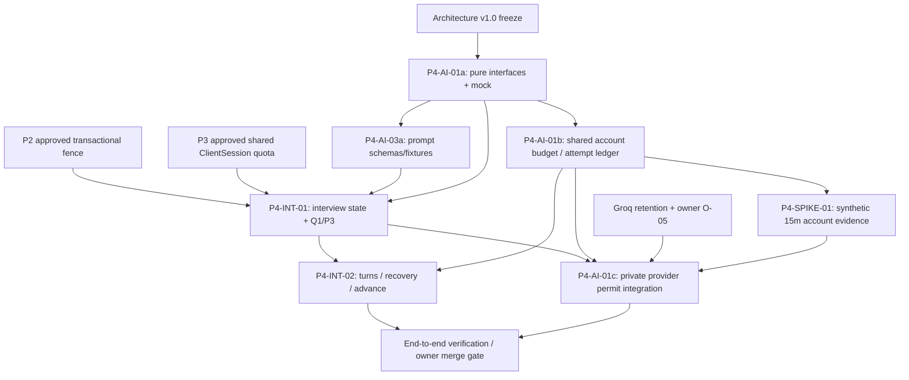

# Roundset Phase 4 — Frozen Implementation Order and Acceptance Gates v1.0
**State:** Architecture freeze complete. Begin atomic implementation, not another general design review.  
**Repository:** https://github.com/silent-knight19/Roundset  
**Governance:** `AGENTS.md`: architect specs/reviews, coding agents implement, owner merges.

## Dependency DAG

## Tickets and discrete acceptance

| Order | Ticket | Agent scope | Acceptance and hard boundary |
|---|---|---|---|
| 1 | **P4-AI-01a** | Typed internal contracts + source/owner provenance rules + deterministic mock | No Mongo, real Groq, cookies, Express routes, external egress; synthetic+owner negative tests pass |
| 2 | P4-AI-03a | Trusted rubric proposal schema and adversarial prompt fixtures | No raw candidate text/JD/README in main rubric authoring; follow-up cannot invent scored main Q |
| 3 | P4-AI-01b | Shared per-provider-account budget/attempt records and one-use mock permits | Mongo atomic account last-slot test; synthetic/candidate share budget; no paid provider |
| 4 | P4-SPIKE-01 | Owner-authorized Groq synthetic calls through same gated ledger | Actual selected-model compatibility, 15-minute synthetic cost/latency/rate/JSON evidence |
| 5 | P4-INT-01 | Interview/claim Mongo state and P2+P3 Q1 atomic publication | Owner/foreign scope, pre-start clock+month decision rule, live Atlas transactions and P3 index evidence |
| 6 | P4-AI-01c | Candidate-private permit/gateway integration | **Blocked** until P2+INT claim+budget fences, privacy O-04/O-05, source record ownership and cancellation tests |
| 7 | P4-INT-02 | Finalize, advance, idempotent leases, resume/reconcile and bounded terminal/refund | Crash and unknown commit, real pause-union, one-active no-stranding, safe DTO tests |
| 8 | P4-INT-GATE | Independent PR audit and end-to-end tests | Owner merges only after real provider+Mongo+browser evidence; P5 UI integration follows |

The DAG identifies **interfaces**, not circular source dependencies. `P4-AI-01a` creates contract shapes; **`P4-INT-01` owns implementation of `interviews` claim CAS**; `P4-AI-01c` integrates those source implementations later. No coding agent invents or changes P2 schema to unblock P4.

## Work now / work later

**READY NOW — P4-AI-01a.** No account secrets or deployment needed. Authoritative reference: `ROUNDSET_PHASE4_ARCHITECTURE_v1.0_IMPLEMENTATION_BASELINE.md` §3–§6, plus ticket below. Existing repo main may advance; agent first checks branch/PR collisions and builds from latest main. Review changes with actual tests, not report assertions.

**BLOCKED until dependencies — P4-INT-01 and P4-AI-01c.** Do not treat green unit tests as evidence that P2 shared fences or P3 transaction APIs exist. Do not run actual private interview prompts until explicit owner privacy/provider signoff.

## Required verification on each applicable PR

`npm ci`, `npm run lint`, `npm run typecheck`, `npm test`, `npm run build`, `npm audit --omit=dev`, `git diff --check`; report exit codes and exact CI head SHA. Run live Atlas integration tests only when authorized against a dedicated test DB with active IP allowlist. Do not weaken allowlists to `0.0.0.0/0` as a convenient workaround.

**Closing rule:** Source reviews happen only for actual changed code and failed acceptance criteria. No further v0.7/v0.8 architecture re-audit cycle.
